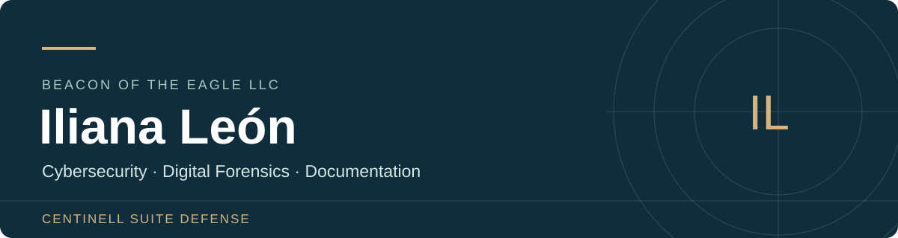

# Iliana León
**Founder, Centinell Suite Defense · Beacon of the Eagle LLC**

I develop projects in cybersecurity, digital forensics, technical documentation and educational applications. My work connects graduate education with investigation scenarios, prototypes and tools that support human decision-making.

[Corporate website](https://www.centinellsuitedefence.com/) · [LinkedIn](https://www.linkedin.com/in/iliana-leon-b72030135/) · [GitHub](https://github.com/Centinell2025) · [Contact](mailto:beaconoftheeagle@centinellsuitedefence.com)

**Working and contact language: Spanish.** This portfolio is presented in English.

## HTML portfolio

The complete visual portfolio is available in [index.html](index.html). Download the file and open it in a browser to use the project filters, project notes, contact links and print layout. It is self-contained and requires no installation.

## Focus

- **Digital forensics and incident response:** log correlation, timelines, evidence integrity and clearly bounded conclusions.
- **Technical education:** fictional training scenarios, synthetic evidence and student documentation.
- **Software and systems:** workflow design, prototypes, documentation and functional evaluation.
- **Applied research:** reproducible experiments, synthetic data and review of results.

## Centinell projects

| Project | Purpose | Presented status |
| --- | --- | --- |
| **OceanCentinell Enterprise** | Maritime cybersecurity and operational visibility. | Development and technical evaluation; implementation scope requires separate validation. |
| **Centinell Forensics / ForensicCentinell** | Case organization and documentation for digital investigations. | In development; capabilities must be checked in the evaluated version. |
| **SkyguardCentinell Twins** | Research into models and continuity between nodes. | Civilian offline research baseline using synthetic temperatures; not an operational real-hardware deployment. |

These public descriptions summarize the projects. Private source code remains reserved.

[Project notes and scope](docs/PROJECTS.md)

## Selected public training work

| Project | Investigation focus | Material |
| --- | --- | --- |
| **The Last Evidence Standing** | Correlating incomplete records, reconstructing a timeline and checking evidence integrity. | [Repository and documentation](https://github.com/Centinell2025/the-last-evidence-standing) |
| **The Silent Payload** | Offline simulated-incident investigation, triage and artifact-supported reporting. | [Repository and exercises](https://github.com/Centinell2025/CENTINELL-The-Silent-Payload) |
| **The Forgotten Session** | Account and authentication-session correlation using synthetic records. | [Repository and guide](https://github.com/Centinell2025/CENTINELL-The-Forgotten-Session) |
| **EchoTrace — The Missing Evidence** | Outages, data loss and recovery assumptions. | [Development and playtesting](https://github.com/Centinell2025/EchoTrace-The-Missing-Evidence) |

All are fictional educational scenarios. A public repository does not establish external platform acceptance, certification or approval. Private instructor solutions are not included in this portfolio.

## Educational application

**[My First Words Kids — 20 Games With Sound](https://github.com/Centinell2025/My-First-Words-20-Games-Sound-v5.zip)**

Parent-guided early-vocabulary web/PWA project with visual activities and sound. Its repository documents eight languages and learning-language pairs. Speech depends on the device; translations and device behavior require their own reviews. Web-source publication does not confirm mobile-store availability.

## Education

- Master's degree in Cybersecurity.
- Master's degree in Information Technology.

## Approach

I distinguish design goals from verified behavior, identify synthetic scenarios, document the limits of findings and retain human oversight.

My professional interests include digital forensic investigation, technical documentation and technology that can be tested.

## Professional contact

Project discussions, technical documentation and collaboration inquiries in Spanish:

**[beaconoftheeagle@centinellsuitedefence.com](mailto:beaconoftheeagle@centinellsuitedefence.com)**

[Corporate website](https://www.centinellsuitedefence.com/) · [Iliana León on LinkedIn](https://www.linkedin.com/in/iliana-leon-b72030135/)

---

Editorial update: **10 November 2026**. Status descriptions reflect the documented scope reviewed for this presentation; consult each project for current instructions and limitations.
