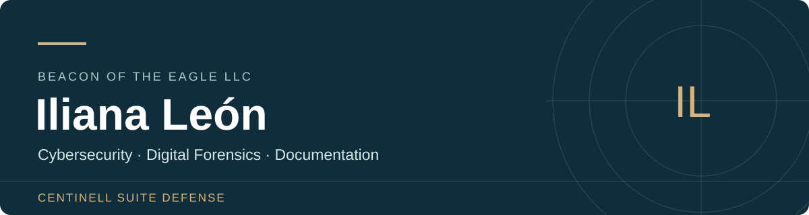

<strong>Español</strong> · <a href="README.en.md">English translation</a>

# Iliana León
**Fundadora de Centinell Suite Defense · Beacon of the Eagle LLC**

Desarrollo proyectos de ciberseguridad, análisis forense digital, documentación técnica y aplicaciones educativas. Mi trabajo conecta la formación de posgrado con escenarios de investigación, prototipos y herramientas para apoyar decisiones con supervisión humana.

[Web corporativa](https://www.centinellsuitedefence.com/) · [LinkedIn](https://www.linkedin.com/in/iliana-leon-b72030135/) · [GitHub](https://github.com/Centinell2025) · [Contacto](mailto:beaconoftheeagle@centinellsuitedefence.com)

**Idioma de trabajo y contacto: español.** La versión en inglés es una traducción de esta presentación.

## Áreas de trabajo

- **Investigación forense digital y respuesta a incidentes:** correlación de registros, cronologías, integridad de evidencias y límites de las conclusiones.
- **Formación técnica:** diseño de laboratorios con escenarios ficticios, evidencias sintéticas y documentación para estudiantes.
- **Software y sistemas:** diseño de flujos de trabajo, prototipos, documentación y evaluación de funciones.
- **Investigación aplicada:** experimentos reproducibles, datos sintéticos y revisión de resultados.

## Proyectos Centinell

| Proyecto | Propósito | Estado presentado |
| --- | --- | --- |
| **OceanCentinell Enterprise** | Ciberseguridad y visibilidad operativa en el ámbito marítimo. | Desarrollo y evaluación técnica; el alcance de una implementación se valida por separado. |
| **Centinell Forensics / ForensicCentinell** | Organización de casos y documentación de investigaciones digitales. | Desarrollo; cada función debe comprobarse en la versión evaluada. |
| **SkyguardCentinell Twins** | Investigación de modelos y continuidad entre nodos. | Base civil de investigación offline con temperaturas sintéticas; no representa un despliegue operativo con equipos reales. |

Las descripciones públicas resumen los proyectos. Su código privado permanece reservado.

[Leer las fichas y los límites de cada proyecto](docs/PROYECTOS.md)

## Laboratorios públicos seleccionados

| Trabajo | Qué permite explorar | Material |
| --- | --- | --- |
| **The Last Evidence Standing** | Correlación de registros incompletos, reconstrucción de una cronología e integridad de evidencias. | [Repositorio y documentación](https://github.com/Centinell2025/the-last-evidence-standing) |
| **The Silent Payload** | Investigación offline de un incidente simulado, triage y elaboración de conclusiones sustentadas en artefactos. | [Repositorio y ejercicios](https://github.com/Centinell2025/CENTINELL-The-Silent-Payload) |
| **The Forgotten Session** | Correlación de cuentas y sesiones de autenticación en registros sintéticos. | [Repositorio y guía](https://github.com/Centinell2025/CENTINELL-The-Forgotten-Session) |
| **EchoTrace — The Missing Evidence** | Análisis de interrupciones, pérdida de datos y supuestos de recuperación. | [Proyecto en desarrollo y pruebas](https://github.com/Centinell2025/EchoTrace-The-Missing-Evidence) |

Estos son escenarios educativos ficticios. Su publicación en GitHub no implica aceptación, certificación ni aprobación por una plataforma externa. Los solucionarios privados no forman parte de este portafolio.

## Aplicación educativa

**[My First Words Kids — 20 Games With Sound](https://github.com/Centinell2025/My-First-Words-20-Games-Sound-v5.zip)**

Proyecto web/PWA de vocabulario temprano con actividades visuales y sonido para uso acompañado por una persona adulta. El repositorio documenta ocho idiomas y selección de pares de aprendizaje. La voz depende del dispositivo; las traducciones y la experiencia en dispositivos requieren sus propias revisiones. La publicación del código web no confirma disponibilidad en tiendas móviles.

## Formación

- Maestría en Ciberseguridad.
- Maestría en Tecnologías de la Información (IT).

## Cómo presento mi trabajo

Distingo la intención de diseño de las funciones verificadas. Documento escenarios sintéticos como tales, explico los límites de los resultados y conservo la intervención humana en las decisiones.

Mi interés profesional se centra en la investigación forense digital, la documentación técnica y el desarrollo de tecnología que pueda ponerse a prueba.

## Contacto profesional

Para conversar sobre los proyectos, documentación técnica o colaboraciones:

**[beaconoftheeagle@centinellsuitedefence.com](mailto:beaconoftheeagle@centinellsuitedefence.com)**

[Centinell Suite Defense / Beacon of the Eagle LLC](https://www.centinellsuitedefence.com/) · [LinkedIn de Iliana León](https://www.linkedin.com/in/iliana-leon-b72030135/)

---

Actualización editorial: **10 de noviembre de 2026**. Los estados describen el alcance documentado al preparar esta presentación; consulta cada repositorio para sus instrucciones y limitaciones vigentes.
